# Aplikasi Es Teh

Aplikasi Penjualan dan Persediaan Bahan Baku UMKM Es Teh
Mata Kuliah: Mobile and Web Application Development

## Identitas

- **Nama:** Aisha Lufita
- **NIM:** 23.01.55.0012
- **Kelas:** A1
- **Semester:** 7 (Ganjil 2026/2027)

## Deskripsi

Aplikasi ini membantu UMKM es teh untuk:
- Mencatat penjualan (pilih menu, atur jumlah & tingkat gula)
- Melihat stok bahan baku dengan status Aman/Menipis/Habis
- Melihat laporan penjualan, laba kotor, dan menu terlaris
- Mengelola menu dan resep (bahan per gelas)
- Menambah menu baru melalui form dengan validasi input

## Screenshot Aplikasi

Seluruh screenshot diambil langsung dari aplikasi yang berjalan (Flutter Web, viewport
420×900), bukan mockup. Data yang tampil adalah data simulasi aplikasi.

### Halaman Utama (Minggu 6)

#### Halaman Menu dan Resep

Daftar menu beserta kategori, harga, dan status ketersediaan. Setiap kartu dapat diketuk
untuk membuka halaman resep.

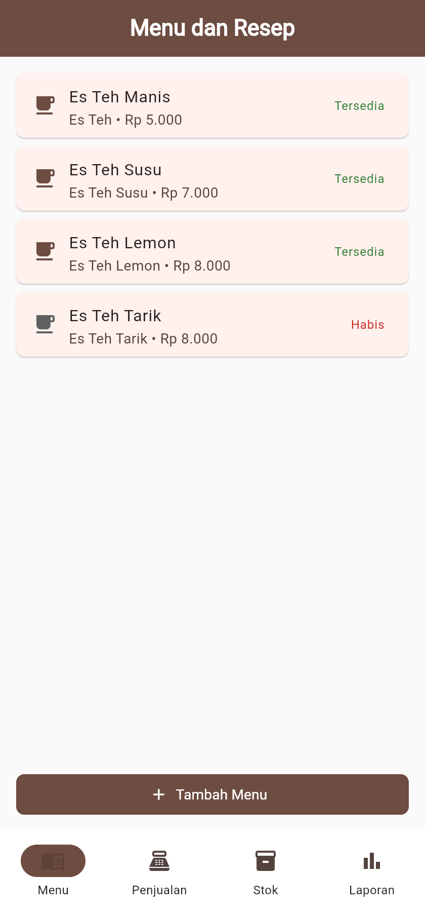

#### Halaman Penjualan

Pemilihan menu dengan pengatur jumlah, pilihan tingkat gula (Normal/Less/Extra), dan total
yang dihitung otomatis. Contoh: 2 Es Teh Manis + 1 Es Teh Susu = Rp 17.000.

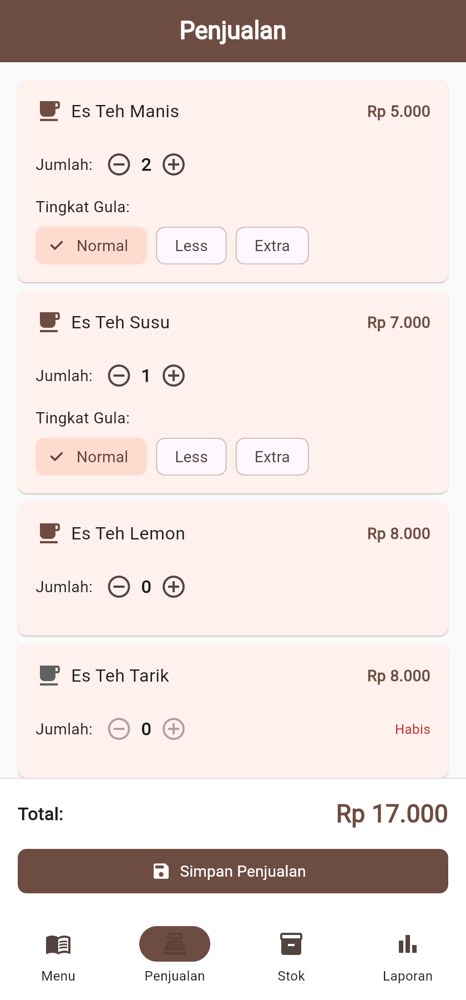

#### Halaman Stok Bahan

Stok setiap bahan dengan batas minimum dan badge status: **Aman** (hijau) dan
**Menipis** (oranye). Gula berstatus Menipis karena stok 80 gram di bawah minimum 200 gram.

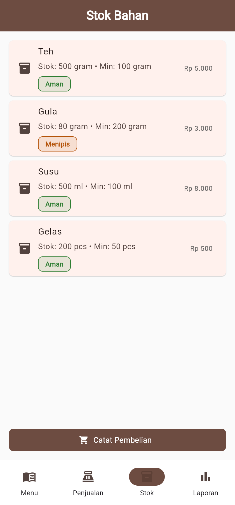

#### Halaman Laporan

Ringkasan total penjualan, laba kotor, jumlah gelas terjual, menu terlaris, dan rincian
penjualan per tanggal yang bisa dibuka.

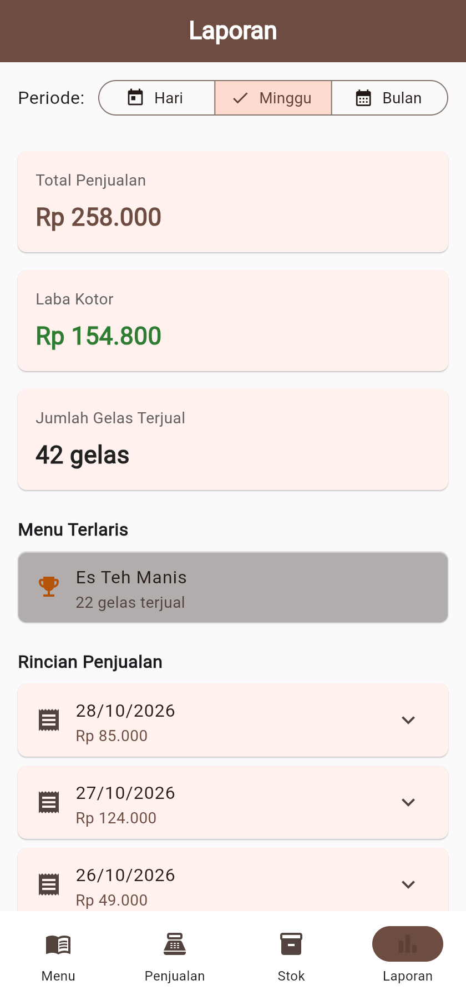

#### Navigasi Push: Halaman Turunan Resep

Halaman turunan yang dibuka dengan `Navigator.push` saat kartu menu diketuk. Tombol
**Kembali** memanggil `Navigator.pop` untuk kembali ke daftar menu.

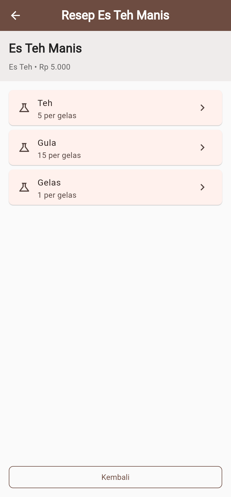

#### Keadaan Kosong

Saat data simulasi dikosongkan, setiap halaman menampilkan pesan keadaan kosong yang jelas
alih-alih daftar kosong tanpa keterangan.

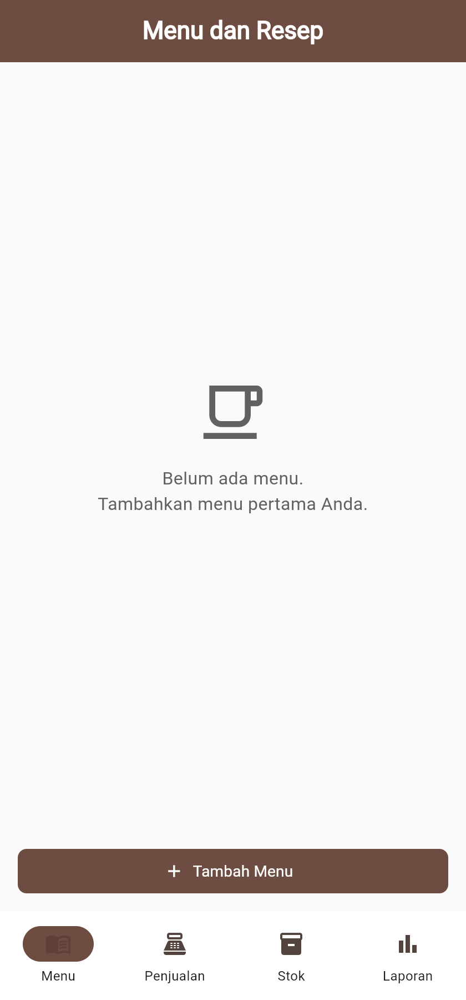

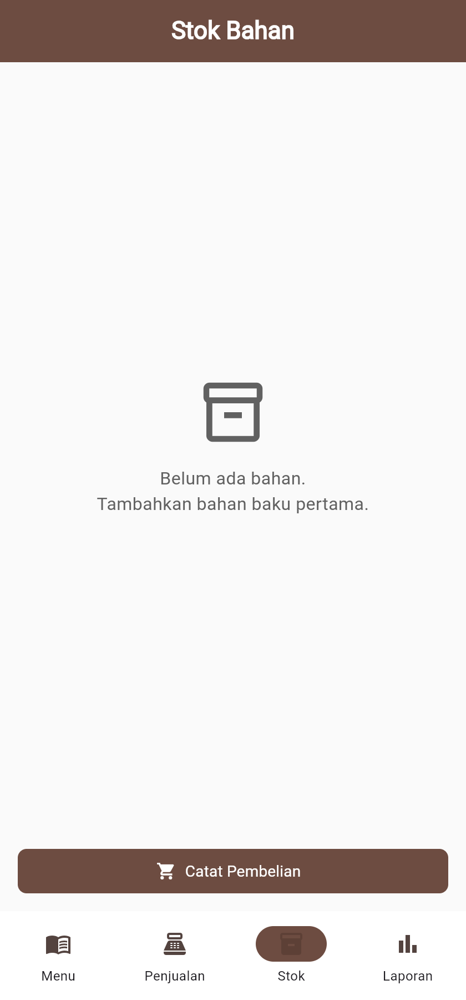

### Form dan Validasi (Minggu 7)

#### 1. Form Tambah Menu

Halaman form dengan empat kolom input: Nama Menu, Kategori (dropdown),
Harga, dan Ketersediaan (switch).

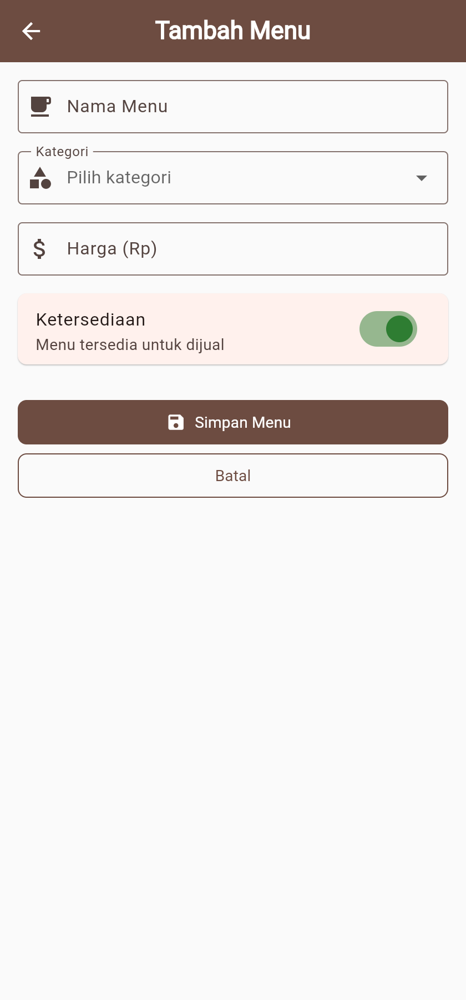

#### 2. Validasi Input

Ketika tombol **Simpan Menu** ditekan dalam keadaan kosong, setiap kolom
menampilkan pesan kesalahan dan SnackBar merah "Periksa kembali data yang dimasukkan" muncul.

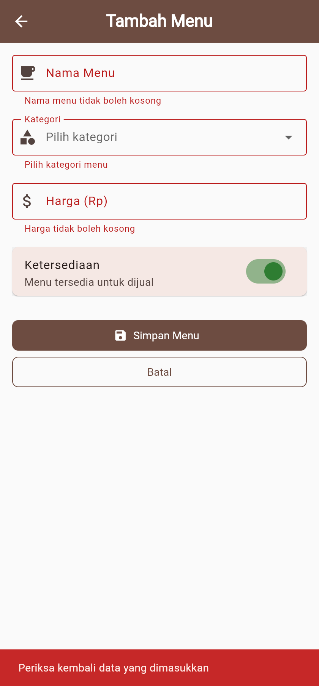

#### 3. Berhasil Menambah Menu

Setelah data valid disimpan, muncul SnackBar hijau
"Menu "Es Teh Melon" berhasil ditambahkan" dan menu baru langsung masuk ke daftar.

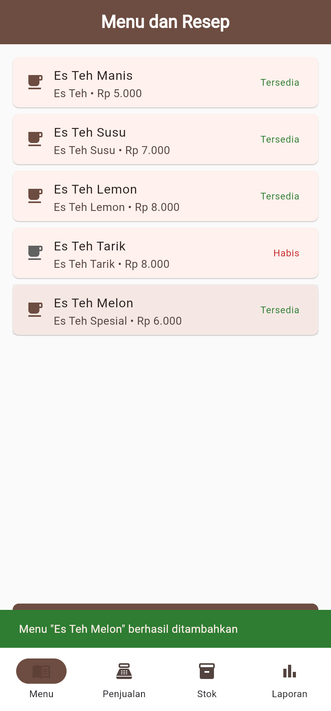

#### 4. Daftar Menu Setelah Menambah Data

Halaman daftar menu setelah penyimpanan. Menu **Es Teh Melon** (kategori Es Teh Spesial,
Rp 6.000, Tersedia) tampil bersama menu simulasi lainnya.

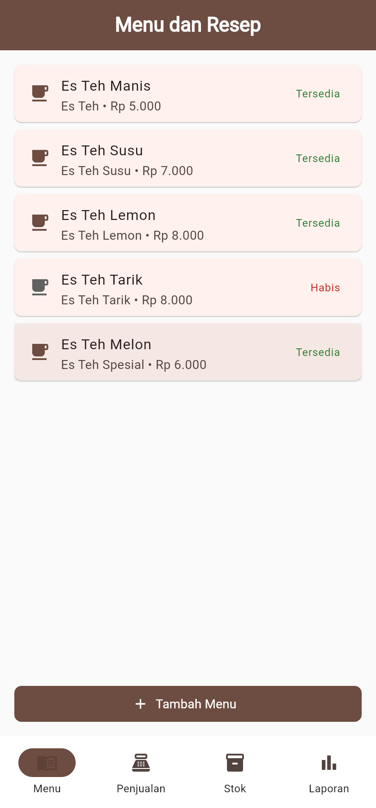

## Halaman Utama (Must)

| Halaman | File | Fungsi |
|---------|------|--------|
| Menu dan Resep | `lib/pages/menu_resep_page.dart` | Daftar menu, tombol Resep, tombol Tambah Menu |
| Penjualan | `lib/pages/penjualan_page.dart` | Pilih menu, atur jumlah & gula, total, Simpan |
| Stok Bahan | `lib/pages/stok_bahan_page.dart` | Daftar bahan, status stok, tombol Catat Pembelian |
| Laporan | `lib/pages/laporan_page.dart` | Periode, total penjualan, laba kotor, menu terlaris |

### Halaman Turunan

| Halaman | File | Cara Buka | Cara Kembali |
|---------|------|-----------|-------------|
| Resep Menu | `lib/pages/resep_page.dart` | `Navigator.push` dari Menu | `Navigator.pop` / tombol Kembali |
| Tambah Menu | `lib/pages/menu_form_page.dart` | `Navigator.push` dari Menu | `Navigator.pop` / tombol Batal |

## Form dan Validasi (Minggu 7)

Halaman **Tambah Menu** (`menu_form_page.dart`) mengimplementasikan:

- `Form` + `GlobalKey<FormState>` untuk validasi seluruh form
- 4 kolom input (3+ sesuai syarat):
  1. **Nama Menu** — `TextFormField` (validator: tidak kosong, min 3 karakter, tidak duplikat)
  2. **Kategori** — `DropdownButtonFormField` (validator: tidak boleh kosong)
  3. **Harga** — `TextFormField` dengan keyboard angka (validator: tidak kosong, angka valid, min Rp 1.000, maks Rp 1.000.000)
  4. **Ketersediaan** — `SwitchListTile` (tersedia/habis)
- `AutovalidateMode.onUserInteraction` — validasi muncul saat user mengetik
- `TextEditingController` dengan `dispose()` untuk mencegah memory leak
- Tombol **Simpan** memvalidasi form → SnackBar sukses (hijau) atau error (merah)
- Data valid disimpan ke `List<Menu> daftarMenu` di memori
- Daftar menu di-refresh via `await Navigator.push` + `setState()`

## Navigasi

- **Mobile (< 600px):** `NavigationBar` 4 item di bawah layar
- **Web (>= 600px):** `NavigationRail` di sisi kiri (sidebar)
- **Halaman turunan:** `Navigator.push` + `Navigator.pop`

## Struktur Folder

```
lib/
├── main.dart                      # Entry point + MaterialApp + tema
├── data/
│   └── data_simulasi.dart         # Data menu, bahan, resep, penjualan (mutable)
├── theme/
│   ├── app_colors.dart            # Warna dari style guide Figma
│   └── app_theme.dart             # ThemeData (Material 3)
├── pages/
│   ├── halaman_utama.dart         # Shell: NavigationBar / NavigationRail
│   ├── menu_resep_page.dart       # Halaman 1: Menu dan Resep (StatefulWidget)
│   ├── menu_form_page.dart        # Form Tambah Menu (Minggu 7)
│   ├── penjualan_page.dart        # Halaman 2: Penjualan
│   ├── stok_bahan_page.dart       # Halaman 3: Stok Bahan
│   ├── laporan_page.dart          # Halaman 4: Laporan
│   └── resep_page.dart            # Halaman turunan: Resep per menu
└── widgets/
    ├── keadaan_kosong.dart         # Widget keadaan kosong (ikon + pesan)
    └── status_badge.dart           # Badge Aman/Menipis/Habis

screenshots/                        # Screenshot aplikasi yang berjalan
├── menu-dan-resep.png
├── penjualan.png
├── stok-bahan.png
├── laporan.png
├── resep-menu.png
├── keadaan-kosong-menu.png
├── keadaan-kosong-stok.png
├── form-tambah-menu.png
├── validasi-form.png
├── berhasil-tambah-menu.png
└── daftar-menu.png
```

## Pengujian

File: `test/widget_test.dart` — 11 kasus pengujian:

### Tes Form (Minggu 7)
1. Form kosong — semua validator menolak, SnackBar error tampil
2. Nama kurang dari 3 karakter — validasi menolak
3. Harga bukan angka — validasi menolak
4. Harga di bawah minimum (Rp 1.000) — validasi menolak
5. Harga di atas maksimum (Rp 1.000.000) — validasi menolak
6. Semua data valid — menu berhasil disimpan dan tampil di daftar
7. Nama duplikat — validasi menolak

### Tes Navigasi (Minggu 6)
8. Aplikasi menampilkan halaman Menu dan Resep
9. NavigationBar memiliki 4 tujuan utama
10. Tombol Tambah Menu tampil di halaman Menu
11. Klik menu membuka halaman Resep dengan tombol Kembali

## Style Guide

| Unsur | Warna | Kode |
|-------|-------|------|
| Primer | Cokelat teh | `#6D4C41` |
| Latar | Netral | `#FAFAFA` |
| Aman | Hijau | `#2E7D32` |
| Menipis | Oranye | `#B45309` |
| Galat | Merah | `#C62828` |

Tipografi: 22px (judul), 16px (subjudul), 14px (isi), 12px (keterangan)

## Cara Menjalankan

```bash
# Install dependencies
flutter pub get

# Jalankan di Chrome
flutter run -d chrome

# Analisis kode
flutter analyze

# Pengujian
flutter test
```

## Teknologi

- Flutter 3.47.7 (Channel stable)
- Dart 3.13.5
- Material 3
- Tanpa paket tambahan dari pub.dev

## Catatan

- Minggu 6: Widget, Layout, Halaman, dan Navigasi (data simulasi)
- Minggu 7: Form, Validasi Input, dan State Sederhana
  - Form Tambah Menu dengan `GlobalKey<FormState>`
  - 4 input: TextFormField, DropdownButtonFormField, Switch
  - Validator per kolom + `AutovalidateMode.onUserInteraction`
  - State data di memori (`List<Menu>` mutable)
  - Refresh daftar via `await Navigator.push` + `setState()`
- Firebase akan dihubungkan pada pertemuan berikutnya
