# Aplikasi Es Teh

Aplikasi Penjualan dan Persediaan Bahan Baku UMKM Es Teh
Mata Kuliah: Mobile and Web Application Development

## Identitas

- **Nama:** Aisha Lufita
- **NIM:** 23.01.55.0012
- **Kelas:** A1
- **Semester:** 7 (Ganjil 2026/2027)
- **Wireframe Figma:** [Wireframe Aplikasi Es Teh](https://www.figma.com/design/OIUH6K8uZkULTgP4ne7uVc/Wireframe-Aplikasi-Es-Teh-%E2%80%94-sesuai-referensi?node-id=0-1&t=BqVC1PR9g8v6TiHa-1)
- **Video presentasi UTS:** https://youtu.be/pa9LfBGsTgs

## Deskripsi

Aplikasi ini membantu UMKM es teh untuk:
- Mencatat penjualan (pilih menu, atur jumlah & tingkat gula)
- Melihat stok bahan baku dengan status Aman/Menipis/Habis
- Melihat laporan penjualan, laba kotor, dan menu terlaris
- Mengelola menu dan resep (bahan per gelas)
- Menyimpan seluruh data di Cloud Firestore secara real-time (Minggu 10)
- Menambah menu baru melalui form dengan validasi input
- Masuk, daftar, dan keluar dengan Firebase Authentication (Minggu 9)

## Screenshot Aplikasi

Seluruh screenshot diambil langsung dari aplikasi yang berjalan (Flutter Web, viewport
420×900), bukan mockup. Data yang tampil adalah data simulasi aplikasi.

### Halaman Utama (Minggu 6)

#### Halaman Menu dan Resep

Daftar menu beserta kategori, harga, dan status ketersediaan. Setiap kartu dapat diketuk
untuk membuka halaman resep.

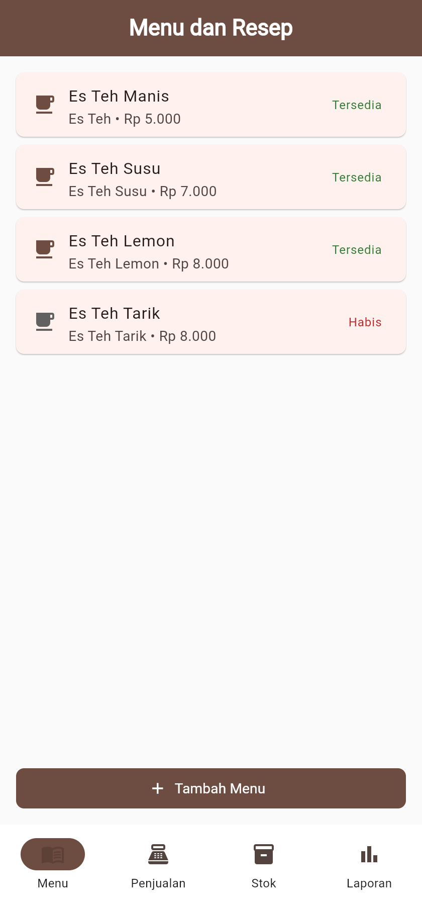

#### Halaman Penjualan

Pemilihan menu dengan pengatur jumlah, pilihan tingkat gula (Normal/Less/Extra), dan total
yang dihitung otomatis. Contoh: 2 Es Teh Manis + 1 Es Teh Susu = Rp 17.000.

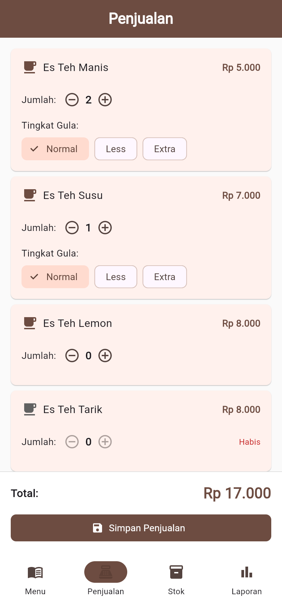

#### Halaman Stok Bahan

Stok setiap bahan dengan batas minimum dan badge status: **Aman** (hijau) dan
**Menipis** (oranye). Gula berstatus Menipis karena stok 80 gram di bawah minimum 200 gram.

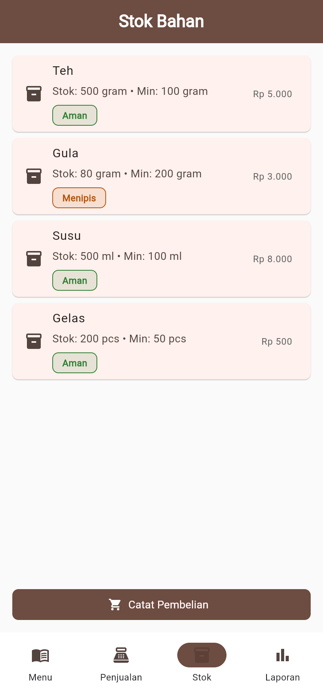

#### Halaman Laporan

Ringkasan total penjualan, laba kotor, jumlah gelas terjual, menu terlaris, dan rincian
penjualan per tanggal yang bisa dibuka.

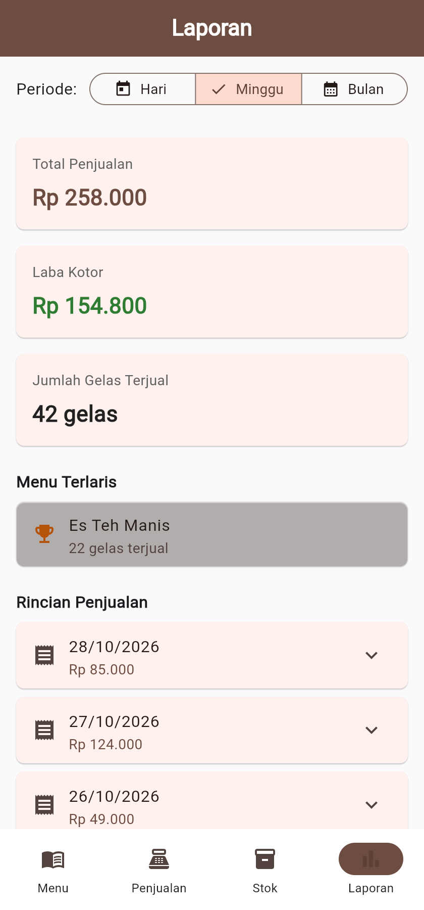

#### Navigasi Push: Halaman Turunan Resep

Halaman turunan yang dibuka dengan `Navigator.push` saat kartu menu diketuk. Tombol
**Kembali** memanggil `Navigator.pop` untuk kembali ke daftar menu.

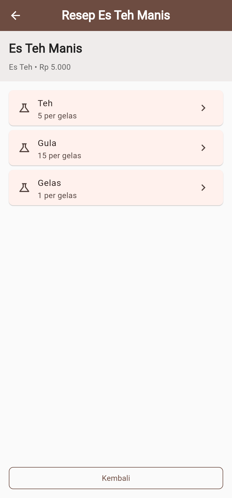

#### Keadaan Kosong

Saat data simulasi dikosongkan, setiap halaman menampilkan pesan keadaan kosong yang jelas
alih-alih daftar kosong tanpa keterangan.

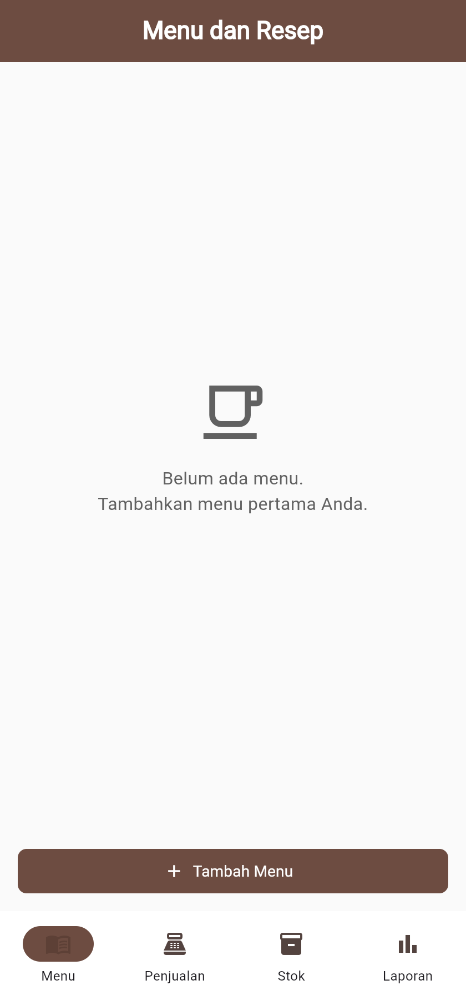

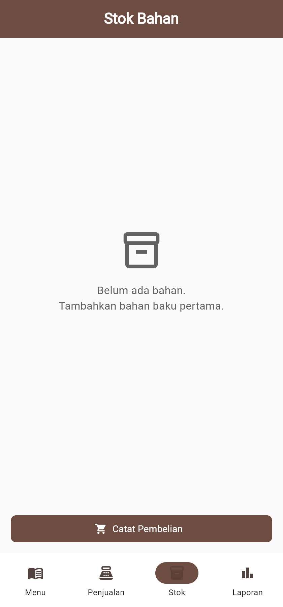

### Form dan Validasi (Minggu 7)

#### 1. Form Tambah Menu

Halaman form dengan empat kolom input: Nama Menu, Kategori (dropdown),
Harga, dan Ketersediaan (switch).

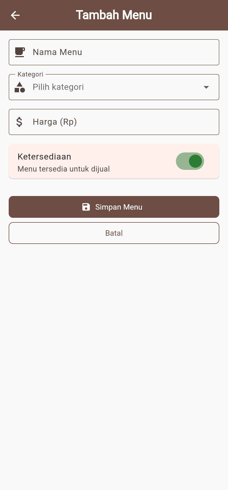

#### 2. Validasi Input

Ketika tombol **Simpan Menu** ditekan dalam keadaan kosong, setiap kolom
menampilkan pesan kesalahan dan SnackBar merah "Periksa kembali data yang dimasukkan" muncul.

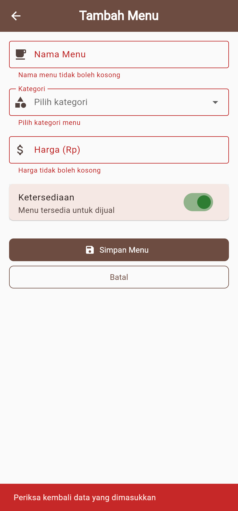

#### 3. Berhasil Menambah Menu

Setelah data valid disimpan, muncul SnackBar hijau
"Menu "Es Teh Melon" berhasil ditambahkan" dan menu baru langsung masuk ke daftar.

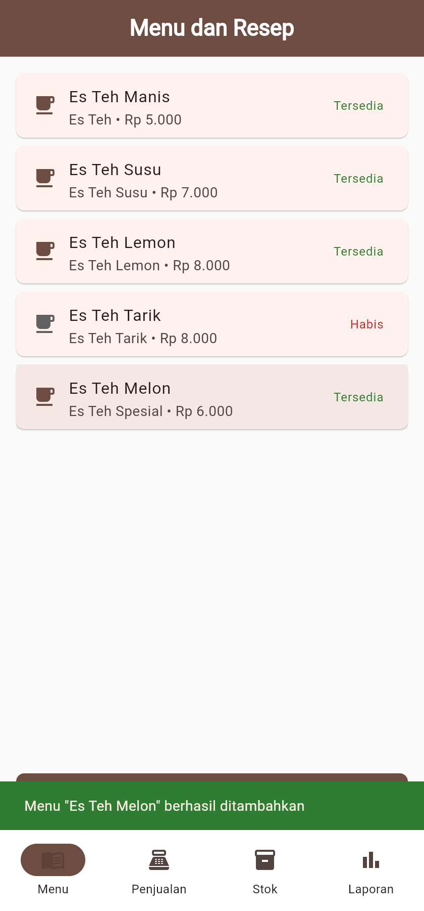

#### 4. Daftar Menu Setelah Menambah Data

Halaman daftar menu setelah penyimpanan. Menu **Es Teh Melon** (kategori Es Teh Spesial,
Rp 6.000, Tersedia) tampil bersama menu simulasi lainnya.

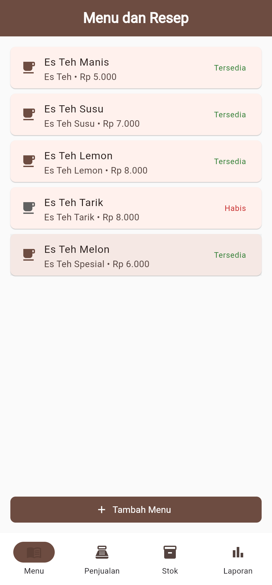

## Halaman Utama (Must)

| Halaman | File | Fungsi |
|---------|------|--------|
| Menu dan Resep | `lib/pages/menu_resep_page.dart` | Daftar menu, tombol Resep, tombol Tambah Menu |
| Penjualan | `lib/pages/penjualan_page.dart` | Pilih menu, atur jumlah & gula, total, Simpan |
| Stok Bahan | `lib/pages/stok_bahan_page.dart` | Daftar bahan, status stok, tombol Catat Pembelian |
| Laporan | `lib/pages/laporan_page.dart` | Periode, total penjualan, laba kotor, menu terlaris |

### Halaman Turunan

| Halaman | File | Cara Buka | Cara Kembali |
|---------|------|-----------|-------------|
| Resep Menu | `lib/pages/resep_page.dart` | `Navigator.push` dari Menu | `Navigator.pop` / tombol Kembali |
| Tambah Menu | `lib/pages/menu_form_page.dart` | `Navigator.push` dari Menu | `Navigator.pop` / tombol Batal |

## Form dan Validasi (Minggu 7)

Halaman **Tambah Menu** (`menu_form_page.dart`) mengimplementasikan:

- `Form` + `GlobalKey<FormState>` untuk validasi seluruh form
- 4 kolom input (3+ sesuai syarat):
  1. **Nama Menu** — `TextFormField` (validator: tidak kosong, min 3 karakter, tidak duplikat)
  2. **Kategori** — `DropdownButtonFormField` (validator: tidak boleh kosong)
  3. **Harga** — `TextFormField` dengan keyboard angka (validator: tidak kosong, angka valid, min Rp 1.000, maks Rp 1.000.000)
  4. **Ketersediaan** — `SwitchListTile` (tersedia/habis)
- `AutovalidateMode.onUserInteraction` — validasi muncul saat user mengetik
- `TextEditingController` dengan `dispose()` untuk mencegah memory leak
- Tombol **Simpan** memvalidasi form → SnackBar sukses (hijau) atau error (merah)
- Data valid disimpan ke `List<Menu> daftarMenu` di memori
- Daftar menu di-refresh via `await Navigator.push` + `setState()`

## Navigasi

- **Mobile (< 600px):** `NavigationBar` 4 item di bawah layar
- **Web (>= 600px):** `NavigationRail` di sisi kiri (sidebar)
- **Halaman turunan:** `Navigator.push` + `Navigator.pop`

## Firebase dan Login (Minggu 9)

Aplikasi terhubung ke project Firebase **es-teh-23010550012** (paket Spark, tanpa billing)
dengan penyedia **Email/Password**. Target platform: Chrome.

### Alur

```
main() → Firebase.initializeApp() → runApp
            ↓
     CekStatusLogin (authStateChanges + StreamBuilder)
       ├── menunggu      → indikator proses
       ├── belum masuk   → MasukPage (mode Masuk / Daftar)
       └── sudah masuk   → HalamanUtama (terlindungi, ada tombol Keluar)
```

- Satu halaman, dua mode: **Masuk** (email + password) dan **Daftar** (+ ulangi password).
- Validasi form: email wajib & format benar, password minimal 6 karakter, ulangi password harus sama.
- Tombol dinonaktifkan selama menunggu jawaban Firebase (`async/await` + `try/catch`).
- Setelah berhasil tidak ada `Navigator`: `CekStatusLogin` mengganti halaman otomatis.
- Sesi login disimpan Firebase sehingga **tetap masuk setelah refresh**, sampai menekan **Keluar**.
- Data penjualan/stok masih di memori (hilang saat refresh) — dipindah ke Firestore pada Minggu 10.

### Pesan Kesalahan

| Kode Firebase | Keadaan | Pesan |
|---|---|---|
| `invalid-credential` | Email tak terdaftar / password salah | Email atau password salah |
| `email-already-in-use` | Daftar dengan email terpakai | Email sudah terdaftar. Silakan masuk. |
| `weak-password` | Password terlalu pendek | Password terlalu lemah, minimal 6 karakter |
| `network-request-failed` | Koneksi gagal | Tidak dapat terhubung. Periksa koneksi internet. |
| `operation-not-allowed` | Penyedia belum aktif | Login email/password belum diaktifkan |

Email tak terdaftar dan password salah sengaja diberi pesan yang sama agar orang lain tidak dapat menebak email mana yang terdaftar.

### Tabel Uji Login

Diuji di Chrome dengan project Firebase asli memakai akun simulasi (bukan password asli).

| # | Kasus uji | Hasil yang diharapkan | Hasil nyata |
|---|---|---|---|
| 1 | Kolom kosong, tekan Masuk | Kedua kolom menampilkan pesan | Sesuai |
| 2 | Email tidak valid (`aisha@`) | Format email belum benar | Sesuai |
| 3 | Daftar akun baru `pemilik@esteh.id` | Langsung masuk ke Halaman Utama | Sesuai |
| 4 | Refresh (F5) setelah masuk | Tetap di Halaman Utama | Sesuai |
| 5 | Tekan Keluar | Kembali ke halaman Masuk | Sesuai |
| 6 | Password salah | Email atau password salah | Sesuai |
| 7 | Daftar dengan email terpakai | Email sudah terdaftar. Silakan masuk. | Sesuai |
| 8 | Login benar | Halaman Utama tampil | Sesuai |

### Bukti: Authentication > Users

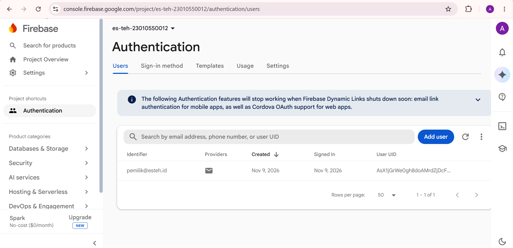

## Cloud Firestore (Minggu 10)

Data aplikasi kini tersimpan permanen di **Cloud Firestore** (project `es-teh-23010550012`,
paket Spark, lokasi Jakarta) dan tampil real-time lewat `StreamBuilder`. Data tidak lagi
hilang saat browser di-refresh.

### Pemetaan ERD ke Collection

| Collection (Doc ID) | Field dan tipe data | Kegunaan |
|---|---|---|
| `users` (uid Auth) | `id_pengguna` String, `nama_lengkap` String, `email` String, `peran` String, `dibuat_pada` Timestamp | Profil pemilik usaha; dibuat saat daftar/masuk, dipakai untuk sapaan |
| `menu` (`menu1`… / auto-ID) | `id_menu` String, `nama` String, `kategori` String, `harga` int, `tersedia` bool, `resep` Array<Map>{`id_bahan`, `nama_bahan`, `jumlah_per_gelas`}, `dibuat_pada` Timestamp | Master menu + resep; diisi otomatis (auto-seed) bila kosong |
| `bahan` (`bahan1`…) | `id_bahan` String, `nama` String, `satuan` String, `stok` number, `stok_minimum` number, `harga_beli` int, `isi_kemasan` number | Master stok bahan baku; diisi otomatis bila kosong |
| `penjualan` (auto-ID) | `id_penjualan` String, `id_pengguna` String, `tanggal` Timestamp, `total` int, `biaya_bahan` int, `laba_kotor` int, `items` Array<Map>{`id_menu`, `nama_menu`, `jumlah`, `tingkat_gula`, `subtotal`, `biaya_bahan`} | Transaksi milik satu pengguna |

Relasi: `users` 1–N `penjualan` (lewat `id_pengguna`), `menu` N–N `bahan` (lewat `resep.id_bahan`).

**Denormalisasi terkontrol** (Firestore tidak punya JOIN):
- `resep` disimpan di dalam dokumen `menu` beserta `nama_bahan` → halaman Resep cukup satu kali baca.
- `nama_menu` disalin ke setiap baris `penjualan.items` → Laporan tidak perlu membaca collection `menu`.
- `biaya_bahan` dan `laba_kotor` disimpan saat transaksi → laba kotor tetap benar walau harga bahan berubah kemudian.

### Security Rules

Diterbitkan di Firebase Console (salinan di `firestore.rules`):

```
rules_version = '2';
service cloud.firestore {
  match /databases/{database}/documents {
    match /{document=**} {
      allow read, write: if request.auth != null;
    }
  }
}
```

### Alur Data

- `lib/services/layanan_es_teh.dart` — kontrak `LayananEsTeh` + `LayananScope` (InheritedWidget).
- `lib/services/layanan_firestore.dart` — implementasi Cloud Firestore asli.
- `lib/services/layanan_memori.dart` — implementasi di memori untuk widget test (tanpa internet).
- **Tambah data + aturan bisnis:** `simpanPenjualan` berjalan dalam `runTransaction`: stok dibaca ulang
  dari server, divalidasi (stok tidak cukup → ditolak, tidak ada dokumen berubah), lalu pengurangan
  stok dan dokumen `penjualan` ditulis bersamaan. Form Tambah Menu menolak nama duplikat.
- **Tampil data:** Menu, Penjualan, Stok, dan Laporan memakai `StreamBuilder` dengan tiga keadaan
  (memuat, gagal, data/kosong). Laporan hanya membaca `penjualan` milik pengguna yang login
  (`where('id_pengguna', isEqualTo: uid)`), diurutkan di sisi Dart agar tidak butuh composite index.
- **Auto-seed:** saat Halaman Utama dibuka pertama kali, `menu` dan `bahan` diisi data awal
  dengan `WriteBatch` bila masih kosong.

### Tabel Uji Cloud Firestore

| # | Kasus uji | Langkah | Hasil yang diharapkan | Hasil nyata |
|---|---|---|---|---|
| 1 | Daftar akun baru | Daftar dengan nama lengkap | Dokumen muncul di `users`, Menu menyapa "Halo, <nama>" | Sesuai |
| 2 | Tambah menu valid | Tambah "Es Teh Melon", Rp 6.000 | Dokumen baru di `menu`, tampil paling atas | Sesuai |
| 3 | Tambah penjualan valid | 2 × Es Teh Manis, Simpan | Dokumen baru di `penjualan`; gula di `bahan` turun 30 g; tampil di Laporan | Sesuai |
| 4 | Tolak stok tidak cukup | Pesan gelas melebihi stok gula | SnackBar "Stok bahan tidak cukup — Gula kurang …"; dokumen tidak bertambah | Sesuai |
| 5 | Bertahan saat refresh | Tekan F5 | Sapaan, menu baru, stok, dan laporan tetap tampil | Sesuai |
| 6 | Isolasi antar akun | Keluar, masuk dengan akun kedua | Laporan akun kedua kosong; penjualan akun pertama tidak tampil | Sesuai |
| 7 | Security Rules | Rules Playground: `get /menu/menu1` tanpa autentikasi | Ditolak (Denied) | Sesuai — *Simulated read denied* |

### Bukti: Rules Playground (tanpa login ditolak)

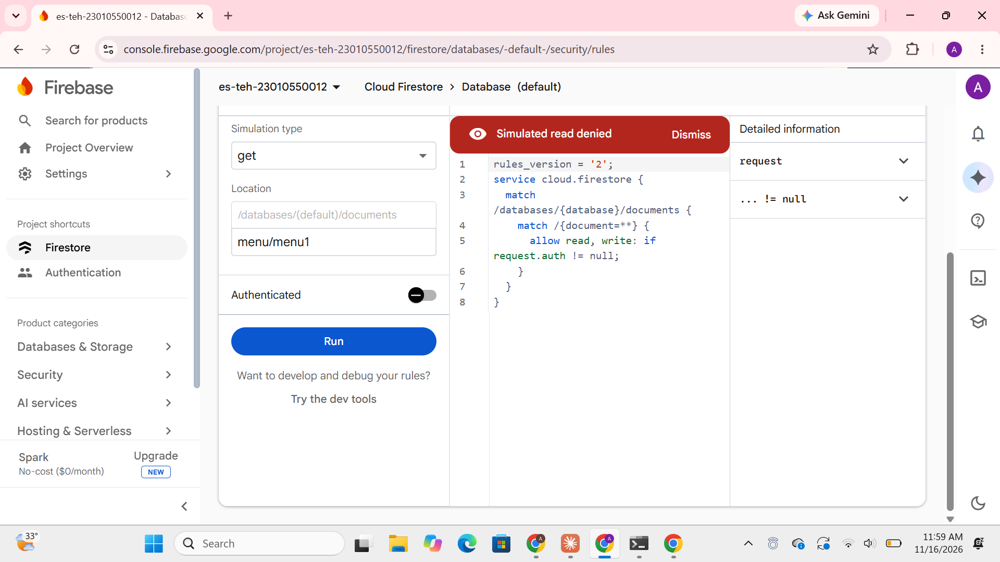

### Bukti: Isi Collection di Firebase Console

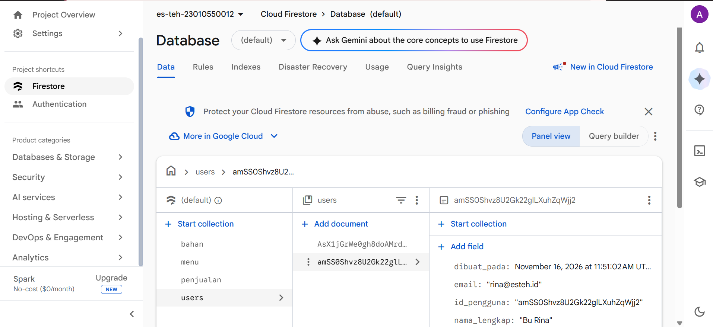
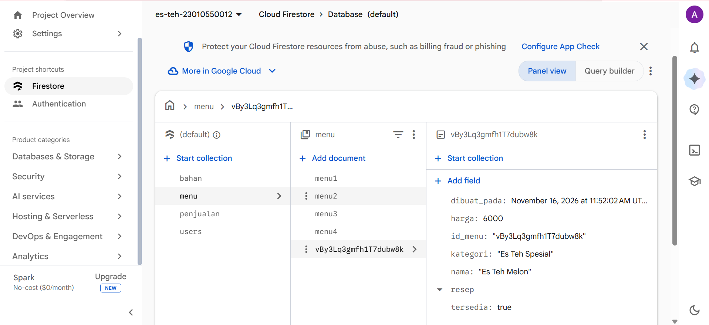
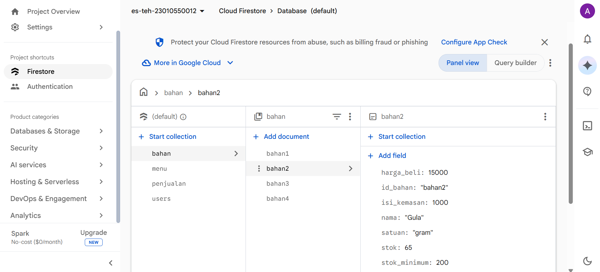
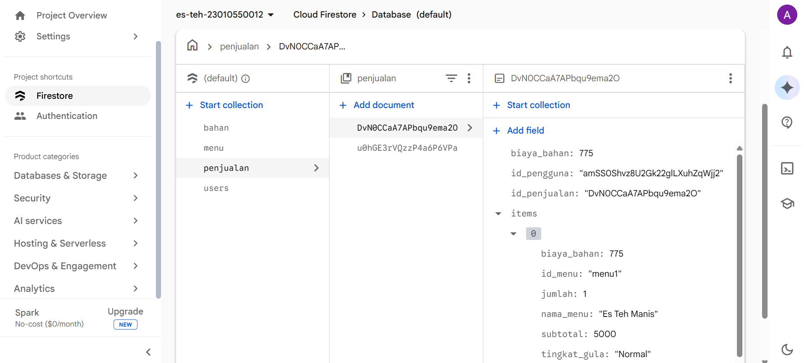

## CRUD Lengkap: Ubah & Hapus (Minggu 11)

Penjualan kini bisa **diubah** dan **dihapus** oleh pemiliknya sendiri, selama statusnya
masih **Tercatat**. Status **Dikunci** (penjualan yang sudah direkap/disetor) diisi manual
di Firebase Console dan membuat penjualan tidak bisa diubah lagi.

### Pemetaan CRUD

| Operasi | HTTP / REST | Firestore | Di aplikasi Es Teh |
|---|---|---|---|
| Create | `POST /penjualan` | `doc().set()` | Simpan Penjualan |
| Read | `GET /penjualan` | `where(...).snapshots()` | Laporan (real-time) |
| Update | `PATCH /penjualan/{id}` | `doc(id).update()` | Menu **Ubah** → halaman Penjualan mode ubah |
| Delete | `DELETE /penjualan/{id}` | `doc(id).delete()` | Menu **Hapus** → dialog konfirmasi |

### Aturan Bisnis

| Aturan | Di kode | Di Security Rules |
|---|---|---|
| Hanya pemilik | `alasanTidakBoleh()`: `id_pengguna == uid` | `resource.data.id_pengguna == request.auth.uid` |
| Hanya status Tercatat | menu aksi `enabled: p.bisaDiubah` | `data.get('status','Tercatat') == 'Tercatat'` |
| Hapus wajib konfirmasi | `showDialog<bool>` sebelum `hapusPenjualan()` | — (tanggung jawab UI) |
| Ubah: stok penjualan lama dikembalikan dulu | `susunUbahPenjualan()` | — (butuh hitungan lintas dokumen) |
| Field audit tetap | `update()` hanya `items`, `total`, `biaya_bahan`, `laba_kotor`, `diubah_pada` | `id_pengguna` tidak boleh berubah |

**Padanan "cek bentrok yang mengecualikan dokumen sendiri":** saat mengubah penjualan,
stok yang dipakai penjualan lama dikembalikan dulu sebelum keranjang baru diperiksa.
Tanpa langkah ini, mengubah 2 gelas menjadi 2 gelas pun bisa ditolak karena stoknya
dianggap terpakai dua kali.

Ubah dan hapus berjalan di dalam `runTransaction`, sehingga dokumen penjualan dan stok
bahan selalu berubah bersamaan. Hapus mengembalikan stok bahan sesuai resep.

### Security Rules Kepemilikan

```
rules_version = '2';
service cloud.firestore {
  match /databases/{database}/documents {

    function sudahMasuk() {
      return request.auth != null;
    }

    function pemilik(data) {
      return sudahMasuk() && data.id_pengguna == request.auth.uid;
    }

    // Dokumen Minggu 10 belum punya field status → dianggap Tercatat
    function masihTercatat(data) {
      return data.get('status', 'Tercatat') == 'Tercatat';
    }

    // Profil: hanya pemiliknya sendiri
    match /users/{uid} {
      allow read, write: if sudahMasuk() && request.auth.uid == uid;
    }

    // Data master usaha: semua pengguna yang login
    match /menu/{idMenu} {
      allow read, write: if sudahMasuk();
    }
    match /bahan/{idBahan} {
      allow read, write: if sudahMasuk();
    }

    // Penjualan: hanya pemilik, ubah/hapus hanya selama status Tercatat
    match /penjualan/{idPenjualan} {
      allow create: if pemilik(request.resource.data)
                    && request.resource.data.status == 'Tercatat';
      allow read: if pemilik(resource.data);
      allow update: if pemilik(resource.data)
                    && masihTercatat(resource.data)
                    && request.resource.data.id_pengguna == resource.data.id_pengguna
                    && masihTercatat(request.resource.data);
      allow delete: if pemilik(resource.data)
                    && masihTercatat(resource.data);
    }
  }
}
```

### Tabel Uji CRUD

| # | Kasus uji | Langkah | Hasil yang diharapkan | Hasil nyata |
|---|---|---|---|---|
| 1 | Ubah data valid | Laporan → ⋮ → Ubah, 2 → 3 gelas, Simpan Perubahan | Total & stok berubah; `tanggal`, `id_pengguna`, `status` tetap; `diubah_pada` terisi | Sesuai — total jadi Rp 15.000, `diubah_pada` terisi, `id_pengguna` tetap |
| 2 | Ubah tanpa menambah jumlah | Ubah penjualan, ganti tingkat gula saja | Tersimpan, tidak ditolak karena stok sendiri | Sesuai — tersimpan, tidak ditolak |
| 3 | Ubah melebihi stok | Ubah jumlah melebihi stok gula | Ditolak "Stok bahan tidak cukup…", data lama utuh | Sesuai — ditolak "Teh kurang 5 gram", data tetap Rp 15.000 |
| 4 | Hapus dengan konfirmasi | ⋮ → Hapus → Hapus | Dialog muncul; dokumen hilang; stok kembali; SnackBar berhasil | Sesuai — dokumen hilang, stok kembali (Teh +15, Gula +45, Gelas +3) |
| 5 | Hapus lalu Batal | ⋮ → Hapus → Batal | Dialog tertutup; data tetap ada | Sesuai — dialog tertutup, data tetap ada |
| 6 | Status Dikunci | Ubah `status` jadi `Dikunci` di Console | Ikon gembok, menu Ubah/Hapus nonaktif | Sesuai — ikon gembok, menu Ubah/Hapus nonaktif |
| 7 | Hapus milik akun lain | Rules Playground: `delete` dokumen penjualan dengan UID akun lain | Ditolak (*Simulated delete denied*) | Sesuai — *Simulated write denied* |

### Bukti

Dokumen setelah diubah (`diubah_pada` terisi, pemilik tetap):

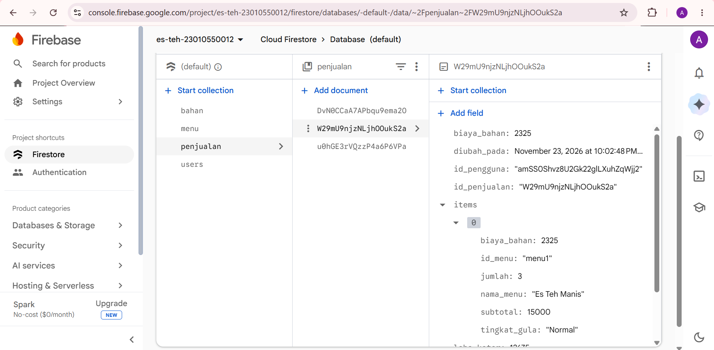

Dialog konfirmasi hapus:

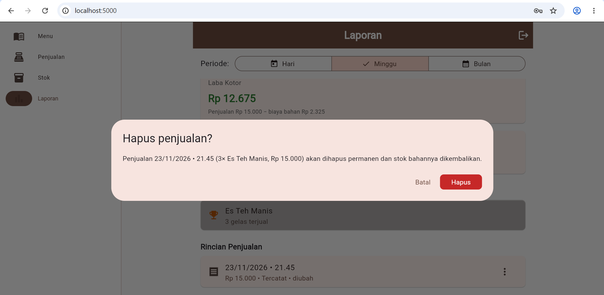

Status Dikunci — menu aksi terkunci:

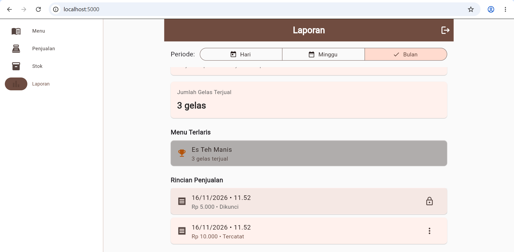

Rules kepemilikan ter-publish; hapus oleh akun lain ditolak di Rules Playground:

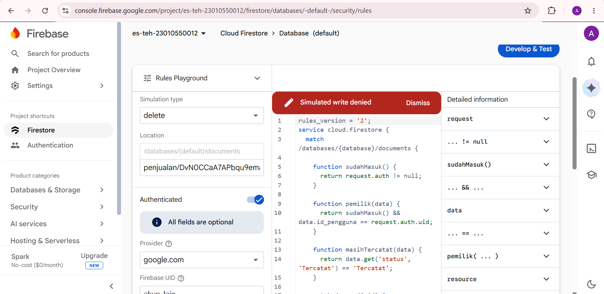

## Struktur Folder

```
lib/
├── main.dart                      # Entry point: Firebase.initializeApp + MaterialApp
├── firebase_options.dart          # Konfigurasi project Firebase (web)
├── auth/
│   └── aturan_login.dart          # Validasi login + terjemahan kode error (Minggu 9)
├── data/
│   └── data_simulasi.dart         # Model + toMap/fromMap, data awal, logika B1–B3 (murni)
├── services/
│   ├── layanan_es_teh.dart        # Kontrak layanan data + LayananScope (Minggu 10)
│   ├── layanan_firestore.dart     # Implementasi Cloud Firestore (Minggu 10)
│   └── layanan_memori.dart        # Implementasi memori untuk test (Minggu 10)
├── theme/
│   ├── app_colors.dart            # Warna dari style guide Figma
│   └── app_theme.dart             # ThemeData (Material 3)
├── pages/
│   ├── cek_status_login.dart      # authStateChanges → Masuk / Halaman Utama (Minggu 9)
│   ├── masuk_page.dart            # Halaman Masuk & Daftar (Minggu 9)
│   ├── halaman_utama.dart         # Shell: NavigationBar / NavigationRail
│   ├── menu_resep_page.dart       # Halaman 1: Menu dan Resep (StatefulWidget)
│   ├── menu_form_page.dart        # Form Tambah Menu (Minggu 7)
│   ├── penjualan_page.dart        # Halaman 2: Penjualan
│   ├── stok_bahan_page.dart       # Halaman 3: Stok Bahan
│   ├── laporan_page.dart          # Halaman 4: Laporan
│   └── resep_page.dart            # Halaman turunan: Resep per menu
└── widgets/
    ├── keadaan_kosong.dart         # Widget keadaan kosong (ikon + pesan)
    ├── tombol_keluar.dart          # Tombol Keluar di AppBar (Minggu 9)
    └── keadaan_stream.dart         # Tampilan memuat / gagal untuk StreamBuilder (Minggu 10)
    └── status_badge.dart           # Badge Aman/Menipis/Habis

screenshots/                        # Screenshot aplikasi yang berjalan
├── menu-dan-resep.png
├── penjualan.png
├── stok-bahan.png
├── laporan.png
├── resep-menu.png
├── keadaan-kosong-menu.png
├── keadaan-kosong-stok.png
├── form-tambah-menu.png
├── validasi-form.png
├── berhasil-tambah-menu.png
├── daftar-menu.png
├── console-users.png             # Bukti akun di Firebase Authentication
└── firestore-*.png               # Bukti isi collection Firestore (Minggu 10)

firestore.rules                     # Security Rules yang diterbitkan
```

## Pengujian

File: `test/widget_test.dart` — 11 kasus pengujian:

### Tes Form (Minggu 7)
1. Form kosong — semua validator menolak, SnackBar error tampil
2. Nama kurang dari 3 karakter — validasi menolak
3. Harga bukan angka — validasi menolak
4. Harga di bawah minimum (Rp 1.000) — validasi menolak
5. Harga di atas maksimum (Rp 1.000.000) — validasi menolak
6. Semua data valid — menu berhasil disimpan dan tampil di daftar
7. Nama duplikat — validasi menolak

### Tes Navigasi (Minggu 6)
8. Aplikasi menampilkan halaman Menu dan Resep
9. NavigationBar memiliki 4 tujuan utama
10. Tombol Tambah Menu tampil di halaman Menu
11. Klik menu membuka halaman Resep dengan tombol Kembali

Widget test memakai `EsTehApp(layanan: LayananMemori(), halamanAwal: HalamanUtama())`
agar tidak memanggil Firebase.

File: `test/logika_penjualan_test.dart` — 16 kasus (9 kasus Minggu 10 + 7 kasus ubah/hapus Minggu 11): biaya bahan dari resep, toMap/fromMap,
pengurangan stok, total & laba kotor, stok tidak cukup ditolak, keranjang kosong,
isolasi penjualan antar akun, status stok, dan profil pengguna.

### Tes Login (Minggu 9)
File: `test/login_test.dart` — 9 kasus (termasuk nama lengkap wajib saat Daftar):
1. Email kosong dan format salah ditolak
2. Password minimal 6 karakter
3. Ulangi password harus sama
4. Email tak terdaftar dan password salah diberi pesan yang sama
5. Kode error lain diterjemahkan ke pesan yang dipahami pengguna
6. Halaman Masuk: kolom kosong — kedua kolom menampilkan pesan
7. Halaman Masuk: email tidak valid dan password pendek ditolak
8. Mode Daftar: ulangi password harus sama

### Tes CRUD (Minggu 11)
- Unit: ubah valid (field audit tetap), ubah tanpa menambah jumlah tidak ditolak, ubah melebihi
  stok ditolak, ubah ke menu lain mengembalikan bahan, hapus mengembalikan stok, status Dikunci
  ditolak, penjualan akun lain ditolak.
- Widget: Hapus → Batal (data tetap), Hapus → konfirmasi (data hilang), Ubah membuka halaman
  yang sama dengan data lama, status Dikunci membuat menu nonaktif.

Total: **40 tes** (`flutter test`).

## Style Guide

| Unsur | Warna | Kode |
|-------|-------|------|
| Primer | Cokelat teh | `#6D4C41` |
| Latar | Netral | `#FAFAFA` |
| Aman | Hijau | `#2E7D32` |
| Menipis | Oranye | `#B45309` |
| Galat | Merah | `#C62828` |

Tipografi: 22px (judul), 16px (subjudul), 14px (isi), 12px (keterangan)

## Cara Menjalankan

```bash
# Install dependencies
flutter pub get

# Jalankan di Chrome
flutter run -d chrome

# Analisis kode
flutter analyze

# Pengujian
flutter test
```

## Teknologi

- Flutter 3.47.7 (Channel stable)
- Dart 3.13.5
- Material 3
- firebase_core 5.1.0, firebase_auth 7.0.1, cloud_firestore 7.1.0
- Firebase (paket Spark): Authentication Email/Password, Cloud Firestore

## Catatan

- Minggu 6: Widget, Layout, Halaman, dan Navigasi (data simulasi)
- Minggu 7: Form, Validasi Input, dan State Sederhana
  - Form Tambah Menu dengan `GlobalKey<FormState>`
  - 4 input: TextFormField, DropdownButtonFormField, Switch
  - Validator per kolom + `AutovalidateMode.onUserInteraction`
  - State data di memori (`List<Menu>` mutable)
  - Refresh daftar via `await Navigator.push` + `setState()`
- Minggu 9: Firebase dan Login
  - Project Firebase Spark + penyedia Email/Password
  - Halaman Masuk/Daftar, cek status login, tombol Keluar
  - Pesan kesalahan dari `FirebaseAuthException.code`
  - Sesi bertahan setelah refresh
- Minggu 10: Cloud Firestore
  - Collection users, menu (+resep), bahan, penjualan dengan Security Rules `request.auth != null`
  - Tambah menu & penjualan ke Firestore; penjualan ditolak bila stok tidak cukup (transaction)
  - StreamBuilder real-time, penjualan terpisah per pengguna, data bertahan setelah refresh
- Minggu 11: CRUD lengkap
  - Ubah penjualan (halaman yang sama, mode ubah) dan hapus lewat dialog konfirmasi
  - Hanya pemilik dan hanya status Tercatat; Rules kepemilikan ter-publish
  - Stok bahan disesuaikan saat ubah dan dikembalikan saat hapus (transaction)
